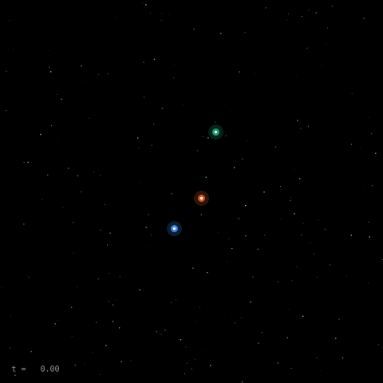
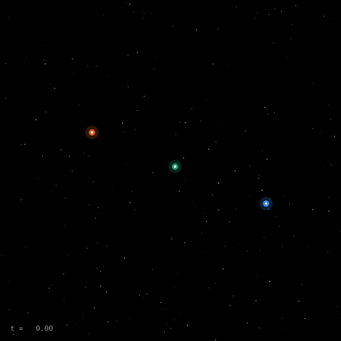
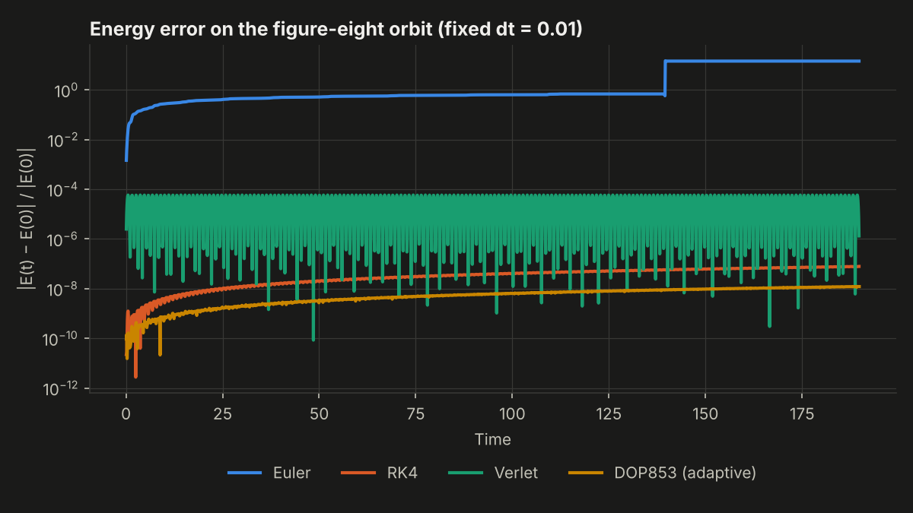
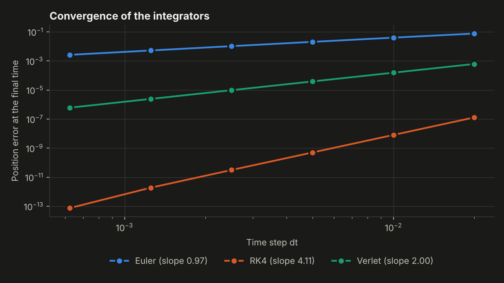
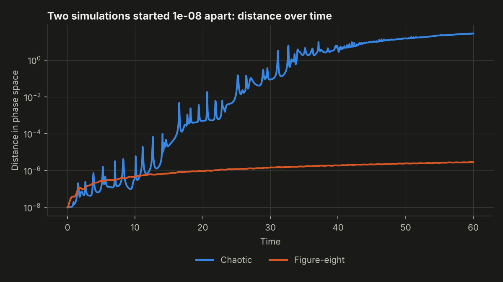
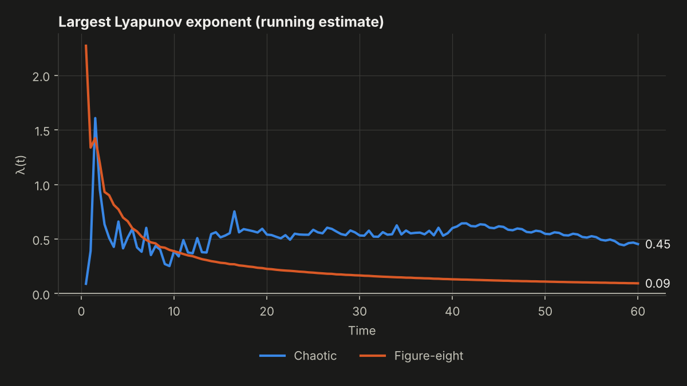
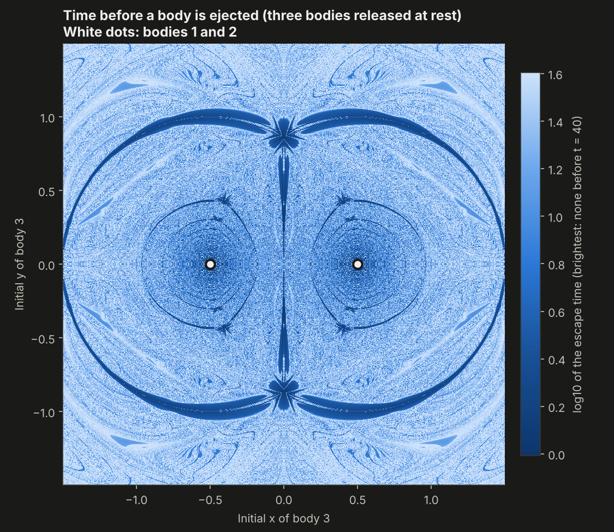

# Problème à trois corps

Simulation du problème à trois corps gravitationnel en Python : trois masses identiques qui s'attirent
selon la loi de Newton. Le projet a trois volets :

1. **comparer des méthodes numériques** (Euler, RK4, Verlet, DOP853) ;
2. **étudier le chaos** (divergence de trajectoires, exposant de Lyapunov, carte du chaos) ;
3. **visualiser** le mouvement en 3D, avec des conditions initiales réglables.

| Départ chaotique | Orbite en huit |
|---|---|
|  |  |

## Le problème en bref

Pour chaque corps $i$, en unités où $G = 1$ :

$$\ddot{\mathbf r}_i = \sum_{j \neq i} m_j \, \frac{\mathbf r_j - \mathbf r_i}{\lVert \mathbf r_j - \mathbf r_i \rVert^3}$$

Avec deux corps, la solution est connue (les ellipses de Kepler). Avec trois, il n'existe pas de solution
générale en formule fermée, et le mouvement est en général **chaotique** : deux départs presque identiques
donnent rapidement des trajectoires complètement différentes. Il reste quelques solutions régulières,
comme l'orbite en huit ou le triangle de Lagrange.

La dynamique exacte conserve l'énergie, la quantité de mouvement et le moment cinétique.
Ces grandeurs servent ici à contrôler la qualité des simulations.

## Installation

Dans le terminal PowerShell de VS Code, depuis le dossier du projet, avec l'environnement virtuel activé :

```powershell
python -m pip install -e ".[dev]"
```

Cette commande installe le package `threebody` (le dossier `src/threebody`) et ses dépendances :
numpy, scipy, matplotlib, pytest, ipykernel.

Pour vérifier que tout fonctionne :

```powershell
python -m pytest
```

## Utilisation

Toutes les commandes se lancent depuis le dossier du projet.

### Animations 3D

```powershell
python scripts/animate.py --scenario chaotic
python scripts/animate.py --scenario figure_eight
python scripts/animate.py --scenario lagrange
```

Une fenêtre s'ouvre ; on peut faire tourner la vue à la souris. Pour enregistrer un GIF à la place :

```powershell
python scripts/animate.py --scenario chaotic --save output/chaotic.gif
```

| Scénario | Description |
|---|---|
| `chaotic` | Départ 3D quelconque : le cas général, chaotique. Un corps finit par être éjecté. |
| `figure_eight` | Orbite en huit (Chenciner et Montgomery, 2000) : périodique et stable. |
| `lagrange` | Triangle équilatéral en rotation (Lagrange, 1772) : solution exacte mais instable, le triangle se brise après environ sept tours. |

### Choisir ses conditions initiales

Le fichier [`configs/custom.toml`](configs/custom.toml) contient la masse, la position et la vitesse
initiales de chaque corps. Le corps 1 sert de référence (conditions initiales fixées) ; les corps 2 et 3
sont libres. Ensuite, les trois corps bougent librement : c'est le vrai problème à trois corps.

```powershell
python scripts/animate.py --config configs/custom.toml
```

Pour explorer sans éditer le fichier à la main, l'explorateur interactif propose un curseur par coordonnée :

```powershell
python scripts/interactive.py
```

Les orbites se recalculent à chaque mouvement de curseur. Le bouton « Save config » écrit les valeurs
dans le fichier, qu'on peut ensuite animer avec la commande précédente.

Avec `recenter = true`, la simulation est affichée dans le référentiel du centre de masse :
la physique est la même, mais le système ne dérive pas hors de l'écran.

### Comparer les méthodes numériques

```powershell
python scripts/compare_integrators.py
```



Même problème (orbite en huit, 30 périodes), même pas de temps. L'énergie devrait rester constante.

| Méthode | Ordre | Erreur relative maximale sur l'énergie |
|---|---|---|
| Euler explicite | 1 | 15 (l'orbite est détruite) |
| Velocity Verlet | 2 | 6 × 10⁻⁵, sans dérive |
| RK4 | 4 | 8 × 10⁻⁸, en lente augmentation |
| DOP853 (pas adaptatif) | 8 | 1 × 10⁻⁸ |

Verlet est moins précis que RK4 à chaque pas, mais son erreur oscille sans grandir : c'est un schéma
symplectique. RK4 est plus précis, mais son erreur s'accumule.



Les pentes mesurées retrouvent les ordres théoriques (1, 2 et 4).

### Étudier le chaos

```powershell
python scripts/chaos_divergence.py
```



Deux simulations démarrent à 10⁻⁸ l'une de l'autre. Pour le départ chaotique, leur distance croît
exponentiellement (une droite en échelle logarithmique) : elle est multipliée par cent millions en
35 unités de temps environ. Pour l'orbite en huit, elle croît lentement.



L'exposant de Lyapunov $\lambda$ mesure ce taux de croissance, $d(t) \approx d_0 \, e^{\lambda t}$.
Il vaut environ 0,5 pour le départ chaotique, et tend vers 0 pour l'orbite en huit. Après $t \approx 40$,
un corps est éjecté du système chaotique : le mouvement redevient régulier et l'estimation diminue.

```powershell
python scripts/chaos_map.py
```



Trois corps sont lâchés sans vitesse. Chaque pixel est une position de départ du troisième corps, et sa
couleur donne le temps écoulé avant qu'un corps soit éjecté. Dans les zones unies, des départs voisins
ont le même destin. Dans les zones mouchetées, deux pixels voisins donnent des résultats sans rapport :
c'est la sensibilité aux conditions initiales. La commande ci-dessus calcule une grille de 150 × 150
(environ une minute) ; l'image affichée ici utilise `--n 400`.

Cette carte est calculée avec une intégration volontairement grossière (force adoucie, pas modéré) :
la structure d'ensemble est fiable, mais pas la valeur de chaque pixel des zones chaotiques.

### Notebooks

Les notebooks du dossier `notebooks/` reprennent ces expériences pas à pas, avec les explications :

- `01_integrators.ipynb` : comparaison des méthodes numériques ;
- `02_chaos.ipynb` : divergence, exposant de Lyapunov, carte du chaos.

Ils s'ouvrent dans VS Code (extension Jupyter), en choisissant le `.venv` du projet comme noyau.

## Structure du projet

```
src/threebody/
    physics.py         forces, énergie, quantité de mouvement, moment cinétique, centre de masse
    integrators.py     Euler, RK4, Verlet (pas fixe) et DOP853 (pas adaptatif)
    scenarios.py       conditions initiales : orbite en huit, Lagrange, chaotique, fichier TOML
    analysis.py        comparaison des intégrateurs, ordre de convergence
    chaos.py           divergence, exposant de Lyapunov, carte des temps d'éjection
    visualization.py   animation 3D
    plots.py           figures de diagnostic
scripts/               commandes décrites ci-dessus
configs/custom.toml    conditions initiales personnalisées
notebooks/             expériences commentées
tests/                 tests automatiques (pytest)
figures/               images de ce README
```

## Ce que vérifient les tests

- la force : cas à deux corps, troisième loi de Newton, cohérence avec le gradient de l'énergie potentielle ;
- les intégrateurs : orbite circulaire à deux corps, ordres de convergence 1, 2 et 4, réversibilité de Verlet,
  conservation de la quantité de mouvement et du moment cinétique ;
- les solutions connues : périodicité de l'orbite en huit, triangle de Lagrange ;
- le chaos : divergence et exposant de Lyapunov plus grands pour le départ chaotique que pour l'orbite en huit.

## Références

- A. Chenciner, R. Montgomery, *A remarkable periodic solution of the three-body problem in the case of equal masses*, Annals of Mathematics, 2000.
- E. Hairer, C. Lubich, G. Wanner, *Geometric Numerical Integration*, Springer, 2006.
- G. Benettin, L. Galgani, A. Giorgilli, J.-M. Strelcyn, *Lyapunov characteristic exponents for smooth dynamical systems and for Hamiltonian systems*, Meccanica, 1980.
- T. A. Agekyan, J. P. Anosova, *A study of the dynamics of triple systems by means of statistical sampling*, Soviet Astronomy, 1967.
